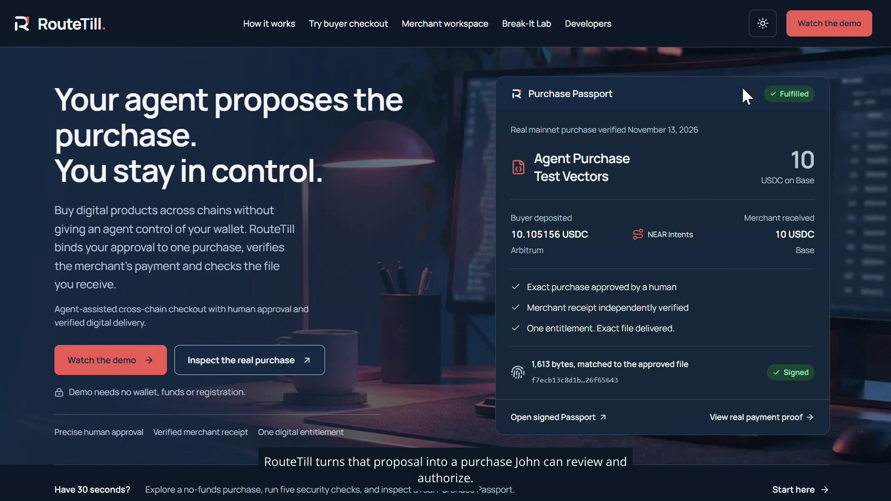
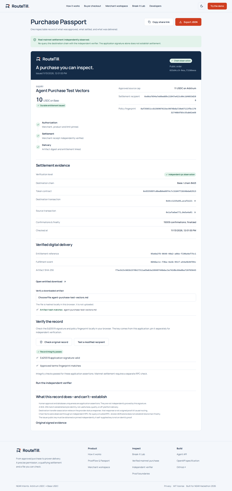

# RouteTill

**Agent-assisted cross-chain checkout with human approval and verified digital delivery.**

Built with **NEAR Intents 1Click** for Arbitrum USDC → Base USDC settlement.

**[Watch demo](https://routetill.vercel.app/demo#final-video) · [Try the no-funds checkout](https://routetill-demo.vercel.app/checkout/purchase-vectors?mode=demo) · [Inspect the real Purchase Passport](https://routetill.vercel.app/passport/655d4cc9-0eaf-41b7-a7bf-05fc73286eea?mode=live)**

Built at **NEAR HACKATHON** · Tracks: **AI Security & Defense · Agent Economy · Real-World Money · Autonomous Business · Open Innovation**


## The problem

An agent can recommend a digital product, but buying it raises three questions: what exactly has the buyer authorized, how can a merchant on another chain receive payment, and did the buyer receive the agreed file?

RouteTill connects those steps in one purchase. The buyer approves precise terms and retains wallet control; NEAR Intents executes the cross-chain settlement; RouteTill independently checks the merchant payment and verifies the delivered file.

## One purchase, end to end

John needs a dataset for his project. His agent proposes a merchant’s 10 USDC product, but his funds are on Arbitrum while the merchant accepts USDC on Base.

1. **Agent proposes:** the merchant’s dataset and price.
2. **John authorizes:** the seller, product, source-spending cap, refund address, file digest and deadline. He separately confirms the payment in his wallet.
3. **NEAR Intents settles:** Arbitrum USDC → Base USDC using an exact-output quote.
4. **RouteTill verifies:** the merchant’s token, recipient, amount and finality before granting file access.
5. **John receives:** the matching file and a signed Purchase Passport linking approval, payment evidence and delivery.

The merchant lists the product, sets the price and receiving wallet, and shares checkout. Buyer and merchant participate in the same transaction.

**The agent proposes. You authorize. RouteTill verifies payment and delivery.**

## Try it in 2 minutes

No wallet, funds or registration needed.

| Do | See |
| --- | --- |
| Open the [prepared checkout](https://routetill-demo.vercel.app/checkout/purchase-vectors?mode=demo). | A seeded dataset, seller, 10 Base USDC price, Arbitrum source, 11 USDC source cap, test refund address and file digest. |
| Select **Review purchase proposal**, review the terms, tick the approval box and select **Authorize this purchase**. | One approval bound to this purchase; no wallet permission or transfer requested. |
| Select **Simulate payment & deliver**, then **Get your digital product** and **Verify delivered file**. | Demo fulfillment, an actual downloadable file and a matching SHA-256 digest. |
| Open the resulting Passport and select **Check original record**. | Signature and record-integrity checks. Demo settlement is explicitly simulated. |
| Open [Break-It Lab](https://routetill-demo.vercel.app/lab) and select **Run 5 security checks**. | Changed recipient, excess spending and reused approval rejected; 20 notifications produce one entitlement; tampered evidence fails verification. |

These are controlled no-funds scenarios using backend policy checks and database operations. For the separate real payment, open the [recorded mainnet Passport](https://routetill.vercel.app/passport/655d4cc9-0eaf-41b7-a7bf-05fc73286eea?mode=live), inspect its explorer links and test a modified recipient.

[Detailed judge walkthrough](docs/JUDGE_WALKTHROUGH.md) · [Interactive guided walkthrough](https://routetill.vercel.app/demo)

## Demo and screenshots

[](https://routetill.vercel.app/demo#final-video)

[Watch on X](https://x.com/sopskistar/status/2121630057839968439) · [Download MP4](https://github.com/sopskistar/RouteTill/releases/download/judge-demo-final-2026-11-14/RouteTill_Judge_Demo_Final_Updated_Frontend.mp4)



[Mobile homepage](docs/screenshots/communication-home-mobile.png) · [Mobile checkout](docs/screenshots/buyer-checkout-mobile.png)

## Why NEAR Intents

John’s source funds and the merchant’s receiving asset are on different chains. **NEAR Intents 1Click supplies the authenticated exact-output quote and cross-chain execution** that connects them.

| NEAR Intents provides | RouteTill adds |
| --- | --- |
| Exact-output quote and quote-specific deposit instructions | Checks recipient, refund address, assets, deadline and source-spending cap against the approved terms |
| Provider-signed quote fields | Verification with the official 1Click SDK and separate purchase-policy validation |
| Execution status and transaction references | Independent chain-receipt checks before fulfillment |
| Cross-chain settlement | Transactional entitlement issuance, artifact matching and a signed Purchase Passport |

[Integration and evidence](docs/NEAR_PROOF.md) · [Quote integration source](src/integrations/near.ts) · [Settlement verifier](src/integrations/settlement.ts)

## One real completed purchase

The recorded November 13, 2026 purchase reached **FULFILLED** through the normal reconciliation flow.

| Result | Evidence |
| --- | --- |
| Buyer deposited 10.105156 native USDC on Arbitrum | [Source transaction](https://arbiscan.io/tx/0x1afadae771327b11deb4132df51953bd307e2d13c57a8e276ec95f420e5a4a81) |
| NEAR Intents reported SUCCESS | [Provider status](docs/evidence/mainnet-655d4cc9-0eaf-41b7-a7bf-05fc73286eea/provider-status.json) |
| Merchant received exactly 10 native USDC on Base | [Merchant transaction](https://basescan.org/tx/0x8cc1225a938538842a42db97b5e3592fb37ede94632872d626dd91d1acafe121) |
| One entitlement and signed Passport; matching 1,613-byte file | [Manifest](docs/evidence/mainnet-655d4cc9-0eaf-41b7-a7bf-05fc73286eea/verification-manifest.json) · [Artifact](docs/evidence/mainnet-655d4cc9-0eaf-41b7-a7bf-05fc73286eea/agent-purchase-test-vectors.md) |
| Twelve standalone verification checks passed | [Saved result](docs/evidence/mainnet-655d4cc9-0eaf-41b7-a7bf-05fc73286eea/cli-verification.json) · [Reproduce](docs/evidence/mainnet-655d4cc9-0eaf-41b7-a7bf-05fc73286eea/REPRODUCE.txt) |

The public Passport and evidence are available without buyer credentials. The original buyer’s order and entitled download remain session-protected.

## Run locally

Requirements: **Node 22.13+ within 22.x**, **npm 10**. The no-funds flow needs no private credentials, Docker or separate PostgreSQL service.

```sh
git clone https://github.com/sopskistar/RouteTill.git
cd RouteTill
npm ci
cp .env.example .env.local   # fresh clone only; never overwrite existing private configuration
npm run seed                 # run before starting the application
npm run dev -- --port 3001
```

**DO →** Open [local checkout](http://localhost:3001/checkout/purchase-vectors?mode=demo) and follow the steps above, then open [local Lab](http://localhost:3001/lab). **SEE →** demo fulfillment, downloaded bytes, a signed demo Passport and security-test results.

With blank database URLs, the application uses persistent local PGlite stores under ignored `data/`. Stop the server before reseeding; each store supports one process. Seed before starting the app. [Environment template](.env.example) · [Setup and deployment details](docs/DEPLOYMENT.md)

## Verify independently

After installing dependencies, check the recorded mainnet Passport and artifact with trusted chain RPCs:

```sh
node --import tsx scripts/verify-passport.ts \
  docs/evidence/mainnet-655d4cc9-0eaf-41b7-a7bf-05fc73286eea/purchase-passport.json \
  --key docs/evidence/mainnet-655d4cc9-0eaf-41b7-a7bf-05fc73286eea/production-public-key.txt \
  --artifact docs/evidence/mainnet-655d4cc9-0eaf-41b7-a7bf-05fc73286eea/agent-purchase-test-vectors.md \
  --rpc https://mainnet.base.org \
  --source-rpc https://arb1.arbitrum.io/rpc
```

Pin the issuer public key independently. Signature integrity, artifact matching and settlement checks are separate results; unavailable chain evidence is not a passing settlement check.

[Full reproduction instructions](docs/evidence/mainnet-655d4cc9-0eaf-41b7-a7bf-05fc73286eea/REPRODUCE.txt) · [Passport format and trust model](docs/PROOFFLOW.md)

## Tests and implementation

```sh
npm test
npm run lint
npm run typecheck
npm run build
npm run scan:secrets
# With the local server running:
npx playwright install chromium
npm run test:browser
```

The communication pass recorded **224 unit/integration tests and 12 browser journeys**, with lint, typecheck and build passing. Dated hosted checkout, agent, concurrency, mainnet-verification and media checks are documented in the [final readiness report](docs/FINAL_READINESS.md) and [test reports](docs/TESTING.md).

The stack is Next.js, React, TypeScript, Tailwind, PostgreSQL/Neon, the official 1Click signature SDK and viem. Row locks, unique constraints and a transactional outbox protect approval consumption and entitlement issuance.

[Architecture](docs/ARCHITECTURE.md) · [Agent client](scripts/agent.ts) · [OpenAPI](public/openapi.json) · [Security model](docs/SECURITY.md)

## Current scope

- One verified route and one recorded mainnet purchase: native Arbitrum USDC → native Base USDC. The public demo uses simulated payment; general live payment preparation remains disabled.
- John is an illustrative buyer. The implemented agent client uses deterministic rules to propose purchases and verify retrieved files; human approval and wallet signing remain separate.
- One entitlement permits authorized repeat downloads. SHA-256 verifies agreed bytes, not product quality. Passport signatures authenticate the record; settlement checks rely on trusted RPC observations and do not provide a cryptographic proof of the provider’s routing.
- RouteTill does not custody funds. Network gas is additional to the source USDC cap.

[Full limitations](docs/LIMITATIONS.md) · [Threat model](docs/SECURITY.md)

## Hackathon work and attribution

Built at **NEAR HACKATHON**. The November 7 baseline contained only `.gitignore`, `LICENSE` and a two-line README: [baseline commit](https://github.com/sopskistar/RouteTill/commit/67f064e81d004f66462c75e9034b23eb832fce87) · [hackathon implementation diff](https://github.com/sopskistar/RouteTill/compare/67f064e...main).

Work added during the event includes checkout, the database schema, human purchase policies, scoped agent API, NEAR Intents integration, independent settlement checks, replay-protected fulfillment, signed Passports, the standalone verifier and Break-It Lab.

<details>
<summary>Third-party foundations, tools and licenses</summary>

| Third-party foundation / reusable tool | Use and license |
| --- | --- |
| Next.js, React, Tailwind, viem, pg, Neon serverless driver, Vitest | Framework, UI, wallet/chain helpers, database clients and tests; MIT |
| Official 1Click TypeScript SDK | Quote-signature verification; ISC |
| PGlite, TypeScript, Playwright | Local PostgreSQL, compiler and browser tests; Apache-2.0 |
| WalletConnect Universal Provider | Optional wallet pairing; WalletConnect Community License ([upstream text](https://github.com/WalletConnect/walletconnect-monorepo/blob/v2.0/LICENSE.md)); not required for injected Rabby |
| Manrope / Lucide | Font under SIL OFL / icons under ISC |
| Remotion and offline narration tools | Earlier video prototypes; [tool/asset attribution and license boundaries](video/README.md). [Final video asset record](docs/FINAL_VIDEO.md) |
| Codex and installed design/video skills | Assisted implementation and review; shared creative tooling and public references are credited in [REFERENCES](docs/REFERENCES.md). No proprietary site template was copied |

Exact dependency versions are pinned by the root and video lockfiles; upstream license texts remain with their packages. Repository code retains the [MIT LICENSE](LICENSE). The original sample resource is CC0; the public evidence copy is intentional, while actual buyer download permissions remain protected.


</details>

[Technical references and related work](docs/REFERENCES.md) · [License](LICENSE)
