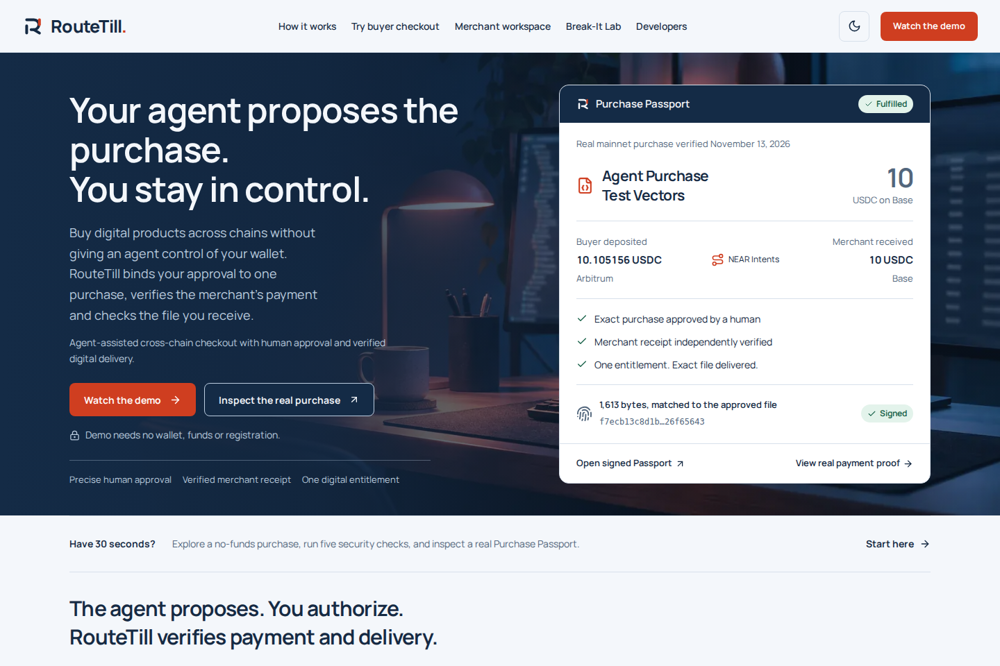

# RouteTill

**Human-approved digital purchases, verified merchant payment and proof of the file delivered.**

An AI agent can suggest a dataset, but the buyer needs control over spending and proof that the intended seller was paid and the correct file arrived. RouteTill binds human approval to one exact purchase, independently checks the merchant's cross-chain receipt, and releases one matching digital entitlement with a signed **Purchase Passport**.

**NEAR's role:** NEAR Intents supplies the authenticated exact-output quote and payment route from native Arbitrum USDC to native Base USDC. RouteTill adds purchase-policy enforcement, independent receipt verification and delivery. It is not a custodial escrow service.



*Actual application capture, not a concept render: the Purchase Passport summarizes our completed purchase. [Full Passport screen](docs/screenshots/passport-desktop.png) · [Mobile checkout](docs/screenshots/buyer-checkout-mobile.png).*

[Production](https://routetill.vercel.app) · [Public no-funds buyer demo](https://routetill-demo.vercel.app/checkout/purchase-vectors?mode=demo) · [Real Purchase Passport](https://routetill.vercel.app/passport/655d4cc9-0eaf-41b7-a7bf-05fc73286eea?mode=live) · [Source](https://github.com/sopskistar/RouteTill)

**Recorded mainnet result — November 13, 2026:** one funded purchase is FULFILLED. NEAR Intents reported SUCCESS; independent chain observations confirmed exactly 10 native Base USDC to the verified merchant. Normal reconciliation issued one entitlement and one signed Passport. General production payment preparation remains disabled; the public demo sends no funds.

**Demo video:** the 91-second narrated Meet John video is rendered for private review. Its public link will be added after owner approval and publication; the older silent video is not presented as current mainnet footage. [Narration and footage plan](docs/DEMO_SCRIPT.md).

## Judges: Start Here

No wallet, registration or owner code is needed for A or B. Merchant and agent administration remain protected. [Detailed walkthrough](docs/JUDGE_WALKTHROUGH.md).

### A. Try a purchase without spending money

1. **DO →** Open the [public buyer checkout](https://routetill-demo.vercel.app/checkout/purchase-vectors?mode=demo) for the prepared **Agent Purchase Test Vectors** dataset. **SEE →** the seller, 10 Base USDC price, Arbitrum USDC source, prepared 11 USDC spending cap, test refund wallet and file SHA-256. The bounded demo fixes these terms; live product checkout retains the cap/refund inputs.
2. **DO →** Select **Review purchase proposal**, review the terms, tick the approval box and select **Authorize this purchase**. **SEE →** one precise, single-use approval; no wallet permission or transfer is requested.
3. **DO →** Select **Simulate payment & deliver**, then **Get your digital product** and **Verify delivered file**. **SEE →** FULFILLED demonstration delivery, one entitlement and downloaded bytes matching the approved digest. Open its Passport and select **Check original record** to check the signed record. Its simulated payment evidence is explicitly separate from mainnet proof.

### B. Run five security checks

1. **DO →** Open [Break-It Lab](https://routetill-demo.vercel.app/lab) and select **Run 5 security checks**. **SEE →** changed recipient, spending above the approved cap and reused approval rejected; 20 notifications (15 concurrent) produce one stored entitlement; altered Passport/file evidence fails verification.
2. **DO →** Expand the results and inspect the linked Passport/download. **SEE →** the allowed terms, attempted change, actual backend outcome and what it establishes. These are controlled no-funds scenarios using real policy validation and Neon database operations, not real financial attacks.

### C. Inspect the real completed payment

1. **DO →** Open the [genuine Purchase Passport](https://routetill.vercel.app/passport/655d4cc9-0eaf-41b7-a7bf-05fc73286eea?mode=live), inspect its explorer links and the [public FULFILLED verification manifest](docs/evidence/mainnet-655d4cc9-0eaf-41b7-a7bf-05fc73286eea/verification-manifest.json). **SEE →** the real Arbitrum transfer, NEAR Intents SUCCESS, exact Base merchant receipt, one entitlement and matching delivered artifact.
2. **DO →** Select **Check original record**, then **Test a modified recipient**. **SEE →** original integrity passes and modified evidence fails. Use the standalone commands below for independent chain verification: a browser signature check alone does not establish settlement.
3. **DO →** Follow the [reproduction instructions](docs/evidence/mainnet-655d4cc9-0eaf-41b7-a7bf-05fc73286eea/REPRODUCE.txt). **SEE →** the signed Passport and the saved 12-check independent result. The [original order page](https://routetill.vercel.app/orders/655d4cc9-0eaf-41b7-a7bf-05fc73286eea?mode=live) and actual entitled download require the purchasing account; the public manifest, Passport and CC0 artifact copy require no buyer credentials.

<details>
<summary>Meet John — the experience behind our first paying purchase</summary>

### Agent finds it — John needs a dataset.

His AI agent finds a useful developer dataset for $10. John wants the file, but he doesn't want to hand over control of his wallet.

### No blank check — His money. His decision.

An agent shouldn't have unrestricted spending power. John wants to buy this one file, not give an agent permission to spend whenever it wants.

### John says yes — One file. One approval.

John sees the seller, the $10 price and the file he's getting. He sets a maximum source spend of 11 USDC and approves this one purchase.

### Payment verified — Paid on Arbitrum. Received on Base.

John sends about $10.11 from his Arbitrum wallet. NEAR Intents handles the cross-chain payment, and RouteTill verifies that the merchant received exactly $10 on Base.

### File + proof — Delivered. With proof.

RouteTill verifies the merchant payment, delivers the correct dataset exactly once, and issues a signed Purchase Passport anyone can check.

Agent discovery is visualized. The financial and delivery claims above refer to the genuine completed purchase. Arbitrum ETH gas is additional to the 11 USDC source ceiling.

</details>

## One real completed purchase

| Verified fact | Evidence |
| --- | --- |
| Human-approved digital product | Agent Purchase Test Vectors; one exact-order approval |
| Buyer funded on Arbitrum One | [10.105156 native USDC transfer](https://arbiscan.io/tx/0x1afadae771327b11deb4132df51953bd307e2d13c57a8e276ec95f420e5a4a81) |
| NEAR Intents settlement | [`SUCCESS` provider response](docs/evidence/mainnet-655d4cc9-0eaf-41b7-a7bf-05fc73286eea/provider-status.json) |
| Merchant paid on Base | [Exactly 10 native USDC received](https://basescan.org/tx/0x8cc1225a938538842a42db97b5e3592fb37ede94632872d626dd91d1acafe121) |
| Other provider reference | [0.095729 USDC refunded to the buyer on Arbitrum](https://arbiscan.io/tx/0x040de1f0e88378fcabcaa141480c5fa5499c329a8d899e4b4426fa7c8a6965a6) |
| FULFILLED order and delivery | [One attempt, one entitlement and one Passport](docs/evidence/mainnet-655d4cc9-0eaf-41b7-a7bf-05fc73286eea/verification-manifest.json); [idempotency check](docs/evidence/mainnet-655d4cc9-0eaf-41b7-a7bf-05fc73286eea/idempotency-check.json); [matching 1,613-byte artifact](docs/evidence/mainnet-655d4cc9-0eaf-41b7-a7bf-05fc73286eea/agent-purchase-test-vectors.md) |
| Delivered SHA-256 | `f7ecb13c8d1b1576b17311ad3eb3a18848f44bdac3a742dbc66e0ba726f65643` |
| Independent verification | [12 standalone checks passed](docs/evidence/mainnet-655d4cc9-0eaf-41b7-a7bf-05fc73286eea/cli-verification.json); [original/tampered results](docs/evidence/mainnet-655d4cc9-0eaf-41b7-a7bf-05fc73286eea/independent-verification.json) |

[Complete verification manifest](docs/evidence/mainnet-655d4cc9-0eaf-41b7-a7bf-05fc73286eea/verification-manifest.json) · [Passport JSON](docs/evidence/mainnet-655d4cc9-0eaf-41b7-a7bf-05fc73286eea/purchase-passport.json) · [Reproduction instructions](docs/evidence/mainnet-655d4cc9-0eaf-41b7-a7bf-05fc73286eea/REPRODUCE.txt)

The provider's association between source deposit and destination transaction is not itself a cryptographic causal proof. RouteTill independently checks the applicable chain receipt, asset, recipient, amount and finality before granting access. The actual download requires the purchasing session; public evidence and a CC0 artifact copy are provided for independent verification.

## Why NEAR Intents is part of the purchase

The buyer paid from Arbitrum while the merchant received USDC on Base. NEAR Intents provided the cross-chain execution; RouteTill did not replace it with a database payment flag or a home-grown bridge.

| NEAR Intents provides | RouteTill builds around it |
| --- | --- |
| Authenticated `POST /v0/quote` with `EXACT_OUTPUT`, native Arbitrum USDC → native Base USDC | [Quote integration](src/integrations/near.ts) binds recipient, refund, assets and exact output to the approved policy and checks input against the spending cap |
| Provider-signed quote fields, verified with the pinned [official SDK](https://github.com/defuse-protocol/one-click-sdk-typescript) | Signature verification plus separate validation of amounts, freshness and terms; optional response metadata is not assumed signed |
| Executable quote-specific deposit address and payment routing | [Approval consumption/execution](src/services/orders.ts), [single-order guard](src/core/live-trial.ts), and [transaction preflight](src/services/payment-preflight.ts); the human confirms the exact ERC-20 transfer in their wallet |
| `GET /v0/status` execution status and transaction references | [Reconciliation](src/services/reconcile.ts) requires SUCCESS and [independently inspects chain receipts](src/integrations/settlement.ts): correct token, merchant, exact amount, canonical block, at least 12 confirmations and finalized Base block; an additional reference must qualify as an origin-chain refund |
| Cross-chain transfer execution | [Transactional delivery](src/services/fulfillment.ts) creates one entitlement, checks the artifact digest and issues a signed Passport; missing or ambiguous settlement evidence prevents delivery |

Official documentation: [quote API](https://docs.near-intents.org/api-reference/oneclick/request-a-swap-quote), [quote signatures](https://docs.near-intents.org/integration/distribution-channels/1click-api/verify-quote-signature), [execution status](https://docs.near-intents.org/api-reference/oneclick/check-swap-execution-status). [Implementation/evidence notes](docs/NEAR_PROOF.md).

This project does not deploy its own NEAR smart contract or implement Chain Signatures, NEAR AI inference or AP2 compatibility. The deterministic example agent proposes purchases; it cannot approve or spend autonomously.

## Run from a fresh clone without private credentials

Use **Node 22.13+ within 22.x** and **npm 10** (verified with Node 22.23.1 / npm 10.9.8). Python 3 is needed only for the secret scanner. No Docker, PostgreSQL service, Neon account, provider JWT or production signing key is needed for the local no-funds flow.

```sh
git clone https://github.com/sopskistar/RouteTill.git
cd RouteTill
npm ci
cp .env.example .env.local   # fresh clone only; never overwrite existing private configuration
npm run seed                 # run before starting the application
npm run dev -- --port 3001
```

**DO →** Open [local buyer checkout](http://localhost:3001/checkout/purchase-vectors?mode=demo) and follow A above, then [local Break-It Lab](http://localhost:3001/lab) and follow B. **SEE →** the same no-code, no-funds flow, local file download, signed demo Passport and tamper detection. Synthetic settlement correctly stays `UNVERIFIED` for mainnet.

The example environment enables the demo and disables live payments. With both database URLs blank, the app creates persistent local PostgreSQL-compatible **PGlite** stores under ignored `data/` and applies its local schema. Seed creates a product and exported demo evidence under ignored `artifacts/demo/`. It does not modify hosted Neon. Stop the local server before reseeding: each store has a single-process lock. If port 3001 is occupied, use `APP_ORIGIN=http://localhost:3005 npm run dev -- --port 3005` and open that origin instead.

**Credential boundaries:** public guest checkout/Lab and offline verification need no secrets. Local merchant/agent administration uses the configured owner-code boundary (blank in this development-only example). Authenticated provider dry quotes need `NEAR_INTENTS_JWT`; hosted deployments need their own separate Neon URL, signing key and authentication/cron settings. An API credential does not enable payment execution. General live preparation remains disabled and the exact-order guard is preserved. Never copy production keys into a judge clone. [Environment template](.env.example) · [deployment guide](docs/DEPLOYMENT.md).

## Verify without the frontend

The actual 2026-11-13 mainnet payment can be checked from a clean clone with public, committed evidence:

```sh
node --import tsx scripts/verify-passport.ts \
  docs/evidence/mainnet-655d4cc9-0eaf-41b7-a7bf-05fc73286eea/purchase-passport.json \
  --key docs/evidence/mainnet-655d4cc9-0eaf-41b7-a7bf-05fc73286eea/production-public-key.txt \
  --artifact docs/evidence/mainnet-655d4cc9-0eaf-41b7-a7bf-05fc73286eea/agent-purchase-test-vectors.md \
  --rpc https://mainnet.base.org \
  --source-rpc https://arb1.arbitrum.io/rpc
```

Use independently trusted RPC endpoints. The public key must be pinned through a separate trusted source. The saved successful result is [here](docs/evidence/mainnet-655d4cc9-0eaf-41b7-a7bf-05fc73286eea/cli-verification.json). This is the **real** purchase, not the demo fixture.

For a separate **synthetic/offline** exercise, a sanitized [authenticated quote recorded on 12 November](docs/evidence/live-dry-quote-2026-11-12.json) and [signed synthetic Passport](docs/evidence/demo-passport.json) are included for offline inspection. The bundled development public key is a test fixture, not a production trust anchor.

```sh
npm run verify -- docs/evidence/demo-passport.json \
  --key docs/evidence/demo-public-key.txt \
  --artifact docs/evidence/field-notes.md
```

The seed writes an actual artifact and signed synthetic Passport:

```sh
npm run verify -- artifacts/demo/passport.json \
  --key artifacts/demo/public-key.pem \
  --artifact artifacts/demo/field-notes.md
```

Expected: `integrity: PASS`, `settlement: UNVERIFIED`, `synthetic: true` and exit 0. To reproduce two independent tamper failures without changing the committed evidence:

```sh
mkdir -p artifacts/readme-verify
node --input-type=module -e "import fs from 'node:fs'; const p=JSON.parse(fs.readFileSync('docs/evidence/demo-passport.json','utf8')); p.payload.approvedTerms.recipient='0x2222222222222222222222222222222222222222'; fs.writeFileSync('artifacts/readme-verify/changed-passport.json',JSON.stringify(p)); fs.writeFileSync('artifacts/readme-verify/changed-file.md',fs.readFileSync('docs/evidence/field-notes.md','utf8')+'\nALTERED\n');"
npm run verify -- artifacts/readme-verify/changed-passport.json \
  --key docs/evidence/demo-public-key.txt --artifact docs/evidence/field-notes.md
# Expected integrity FAIL, exit 1. The next command is a separate test:
npm run verify -- docs/evidence/demo-passport.json \
  --key docs/evidence/demo-public-key.txt --artifact artifacts/readme-verify/changed-file.md
# Expected artifact FAIL, exit 1.
```

For a live Passport, add `--rpc https://your-trusted-base-rpc`; missing independent evidence stays UNVERIFIED and exits 2. Obtain and pin the issuer key independently: a key packaged with a receipt does not establish issuer identity. [Format and trust boundaries](docs/PROOFFLOW.md).

## Test and build

```sh
npm test
npm run lint
npm run typecheck
npm run build
npm run scan:secrets
npm audit
# With the local server running on 3001:
npm run test:browser
```

**Completed checks:** the final presentation release passed **224 unit/integration tests**, **nine Playwright journeys**, typecheck, lint and production build. A credential-free clean clone passed all 224 tests. Hosted fresh-session checkout/delivery and all five Neon-backed Lab checks passed separately; they are not inferred from local PGlite. The full real Neon concurrency/rollback/reconnect report is [here](docs/evidence/neon-verification.json). [Dated results and historical failures](docs/TESTING.md) · [final engineering/security review](docs/FINAL_AUDIT.md) · [README reproduction results](docs/README_VERIFICATION.md).

Browser tests require Chromium: run `npx playwright install chromium` once if absent, keep the local server running, then `npm run test:browser`. On minimal Linux hosts, `npx playwright install --with-deps chromium` also installs required system libraries and may need administrator rights ([Playwright documentation](https://playwright.dev/docs/browsers#install-system-dependencies)). Set `PLAYWRIGHT_BASE_URL=http://localhost:3005` for the alternate port. Physical devices, Safari/Firefox and real WalletConnect pairing were not tested; wallet simulations are identified as mocks. A network/RPC failure is an unavailable check, never proof of settlement.

## Agent integration

[OpenAPI 3.1](public/openapi.json) and [example client](scripts/agent.ts). The example uses deterministic budget rules, not an LLM or unrestricted autonomous spending.

```sh
# Create a limited token in Merchant workspace → Settlement & API.
export ROUTETILL_AGENT_TOKEN='your-scoped-token'
export ROUTETILL_URL=http://localhost:3001
npm run agent
# Open the printed URL and approve as the human owner.
npm run agent -- ORDER_ID
npm run agent -- --quote ORDER_ID
# Live only, after human approval and owner enablement; creates instructions, sends no funds:
npm run agent -- --execute ORDER_ID
```

Tokens cannot approve purchases. A fulfilled run downloads the actual resource, rejects a digest mismatch and saves `artifacts/agent/test-plan.json` when the file is the supported developer dataset. It summarizes fixture labels; it does not execute those test cases or use an LLM. The buyer’s explicitly selected Rabby, MetaMask, Coinbase-compatible injected or other EIP-6963 provider separately requests a transaction signature. WalletConnect needs a public Reown project ID and has not been paired with a real wallet yet. [Agent API and security](docs/SECURITY.md).

## Architecture and deployment

Next.js 16 / React / TypeScript / Tailwind, parameterized typed PostgreSQL queries, official 1Click signature SDK, viem EVM wallet/chain helpers, Vitest and Playwright. Unique constraints and row locks bind approvals, attempts, transfers and entitlements. A transactional outbox and authenticated scheduled reconciliation survive retries. All financial arithmetic uses integer atomic units.

Production and demo use two existing Vercel projects, separate Neon resources and distinct unchanged Passport signing identities. The [real Neon transaction report](docs/evidence/neon-verification.json) records 12 concurrent approval attempts accepting one, rollback, isolation and reconnect persistence using generated test schemas; public migrations were not repeated. Hosted replay also verified 20 notifications to one durable entitlement. WSL networking can be intermittent, so unavailable RPC/database evidence is reported honestly. Both GitHub reconciliation jobs were repaired; [dated workflow evidence](docs/RECONCILIATION.md). [Deployment guide](docs/DEPLOYMENT.md), [architecture](docs/ARCHITECTURE.md), [.env.example](.env.example).

Live deposits are disabled by default after the owner-controlled, completed single-purchase trial. The funded source transaction, merchant settlement, buyer refund and Passport linked above are real evidence from the approved purchase. Do not initiate another transfer without explicit wallet approval.

## What is—and isn’t—the differentiator

Coldtill, Weave, Aurora’s Intents Widget, Penstock and other projects already cover checkout, cross-chain routing, signed notifications and agent-readable payment services. AP2 also defines authorization mandates and linked receipts; RouteTill does not claim to have invented them or to implement AP2 compatibility. RouteTill does not claim those features are unique. Its focus is the **connected authorization → independently qualified settlement → exact digital artifact**, with an executable adversarial challenge and evidence that exposes its limits. [Brief primary-source comparison and attribution](docs/REFERENCES.md).

Application signatures protect assertions; they do not independently prove blockchain settlement, delivery quality or database-wide uniqueness. RPC observations depend on the selected RPC. Provider execution status associates deposits with destination transactions; this association is not a cryptographic causal proof. [Threat model](docs/SECURITY.md), [known limitations](docs/LIMITATIONS.md).

## Documentation and demo assets

- [Judge walkthrough](docs/JUDGE_WALKTHROUGH.md), [demo/video script](docs/DEMO_SCRIPT.md), [submission and X drafts](docs/SUBMISSION.md)
- [NEAR proof](docs/NEAR_PROOF.md), [ProofFlow format](docs/PROOFFLOW.md), [test results](docs/TESTING.md)
- [Security](docs/SECURITY.md), [deployment](docs/DEPLOYMENT.md), [limitations](docs/LIMITATIONS.md), [brand](docs/BRAND.md)

## Hackathon work, baseline and attribution

The [official rules](https://nearhackathon.com/HACKATHON.md) permit qualifying development from **October 19 through November 14, 2026**, with submission closing **November 14 at 23:59 UTC**. The repository was initialized November 7. Baseline [`67f064e`](https://github.com/sopskistar/RouteTill/commit/67f064e81d004f66462c75e9034b23eb832fce87) contains only `.gitignore`, `LICENSE` and a two-line README—not an existing payment application. [Hackathon code diff: baseline → main](https://github.com/sopskistar/RouteTill/compare/67f064e...main).

Work added during the event includes the application and SQL schema; human purchase policies and scoped agent proposals; authenticated NEAR Intents quotes/signature checks; exact transfer and independent settlement verification; transactional, replay-protected delivery; signed Passports and standalone verifier; the five backend security scenarios; and the public no-funds buyer experience. Git history separates the original baseline from this implementation. Next.js/React app scaffolding and framework conventions are third-party foundations, not original hackathon inventions. Third-party code and reusable tools are not claimed as original work.

| Third-party foundation / reusable tool | Use and license |
| --- | --- |
| Next.js, React, Tailwind, viem, pg, Neon serverless driver, Vitest | Framework, UI, wallet/chain helpers, database clients and tests; MIT |
| Official 1Click TypeScript SDK | Quote-signature verification; ISC |
| PGlite, TypeScript, Playwright | Local PostgreSQL, compiler and browser tests; Apache-2.0 |
| WalletConnect Universal Provider | Optional wallet pairing; WalletConnect Community License ([upstream text](https://github.com/WalletConnect/walletconnect-monorepo/blob/v2.0/LICENSE.md)); not required for injected Rabby |
| Manrope / Lucide | Font under SIL OFL / icons under ISC |
| Remotion and offline narration tools | Separate video project; [tool/asset attribution and license boundaries](video/README.md). Reusable video tooling is not payment evidence |
| Codex and installed design/video skills | Assisted implementation and review; shared creative tooling and public references are credited in [REFERENCES](docs/REFERENCES.md). No proprietary site template was copied |

Exact dependency versions are pinned by the root and video lockfiles; upstream license texts remain with their packages. Repository code retains the [MIT LICENSE](LICENSE). The original sample resource is CC0; the public evidence copy is intentional, while actual buyer download permissions remain protected.

## Limitations and publication status

- **One** genuine mainnet purchase is verified; this is not a claim of broad production readiness. Public checkout demonstrates the full journey with no funds. General unrestricted production payment preparation is disabled; a different secure activation architecture is needed for ordinary live customers.
- RouteTill is not custodial escrow. A human explicitly approves the purchase and personally confirms any wallet transfer. ETH gas is additional to the USDC spending cap.
- Provider SUCCESS associates a deposit with reported destination references. Independent RPC observations verify the merchant transfer; that association is not a cryptographic causal proof. Signatures authenticate application assertions, not database-wide uniqueness or product quality. Obtain the issuer key independently and choose trusted RPCs.
- Buyer order pages and entitled downloads require the purchasing session. Judges can inspect the public Passport, sanitized evidence and CC0 file copy without owner credentials. Guest accounts cannot administer merchants or reach production data.
- The narrated video awaits owner review and public publication. The owner will publish the X post and submit the form personally. [Copy-ready submission/X drafts](docs/SUBMISSION.md) contain no invented personal details.
- Keep the repository public through judging and both demos online through **November 18**, preferably **November 25, 2026**; ongoing hosting is an owner obligation, not a future uptime guarantee.
- If **SilentSourcing** is independently submitted, both READMEs must name the other project under Q-015. Its submission is not asserted here; confirm and add reciprocal disclosure before submitting a second project.

[Full limitations](docs/LIMITATIONS.md) · [security model](docs/SECURITY.md).
