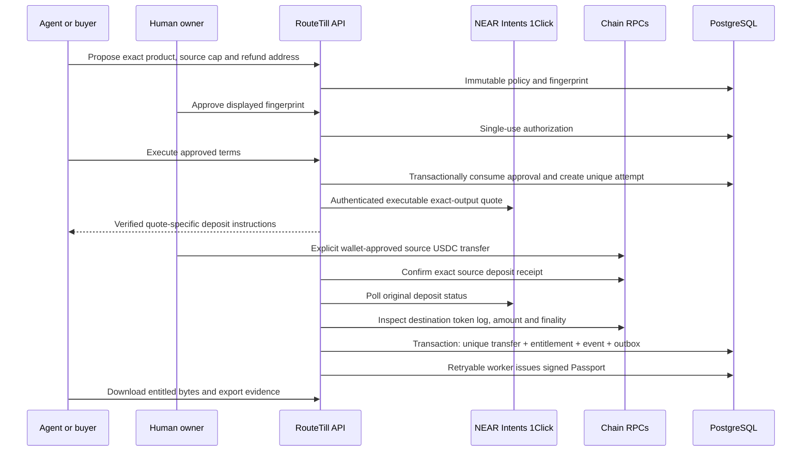

# Architecture

RouteTill has one purchase lifecycle, with an isolated judge mode.

## Modules

`src/core`: exact amounts, immutable policy, state transitions, SHA-256/Ed25519, independent verifier. `src/services`: authentication, products, orders, settlement reconciliation, fulfillment, Passport worker and lab. `src/integrations`: authenticated 1Click access and EVM receipt inspection. `src/db`: typed SQL driver boundary. `src/app/api/[...path]/route.ts`: validated HTTP API. `scripts/agent.ts`: deterministic example client.

## Persistence and concurrency

Production uses Neon-compatible PostgreSQL through `pg` and parameterized SQL. Live and demo URLs must differ. Local no-funds evaluation uses PGlite: PostgreSQL running in-process with files under `data/demo`. It is real SQL persistence, not an in-memory counter and not a Neon integration test. A process lock rejects simultaneous local owners. Stop the server before running seed or migration scripts. Unit tests use fresh temporary PostgreSQL directories.

The migration declares unique order→attempt, order→approval, order→entitlement, attempt→entitlement, idempotency key, deposit address, source transaction, destination `(chain,transaction,log index)`, external event key and outbox `(order,topic)` constraints. Row locks serialize approval consumption and fulfillment per order. A failed artifact check or uniqueness conflict rolls back the transaction.

## Reconciliation and outbox

Attempts are leased durably, checked with bounded exponential backoff (10–300 seconds), and capped at 120 checks. A five-minute authenticated cron checks due attempts and drains the Passport outbox. Interrupted quote creation is failed conservatively after three minutes; its single-use approval is not reopened. A new purchase requires new approval.

The transaction commits the entitlement and outbox intent together. Passport generation is idempotent, and its worker records delivery, attempts and errors. This is exactly-once entitlement issuance within PostgreSQL, not exactly-once external messaging.

An optional HMAC-authenticated reconciliation webhook accepts an attempt identifier and timestamp, then re-fetches provider and chain evidence. It never accepts payment success, a transaction hash association, or synthetic evidence from the caller. Repeated wakeups are constrained by the same durable lease/backoff and fulfillment transaction.

## Deployment

Next.js Node runtime on Vercel; Neon for durable data; an Ed25519 issuer key in server environment; no wallet private key. [Deployment guide](DEPLOYMENT.md) lists the configuration and approval boundary. Source tracing explicitly excludes local keys, data, environment files, captures and video outputs.
